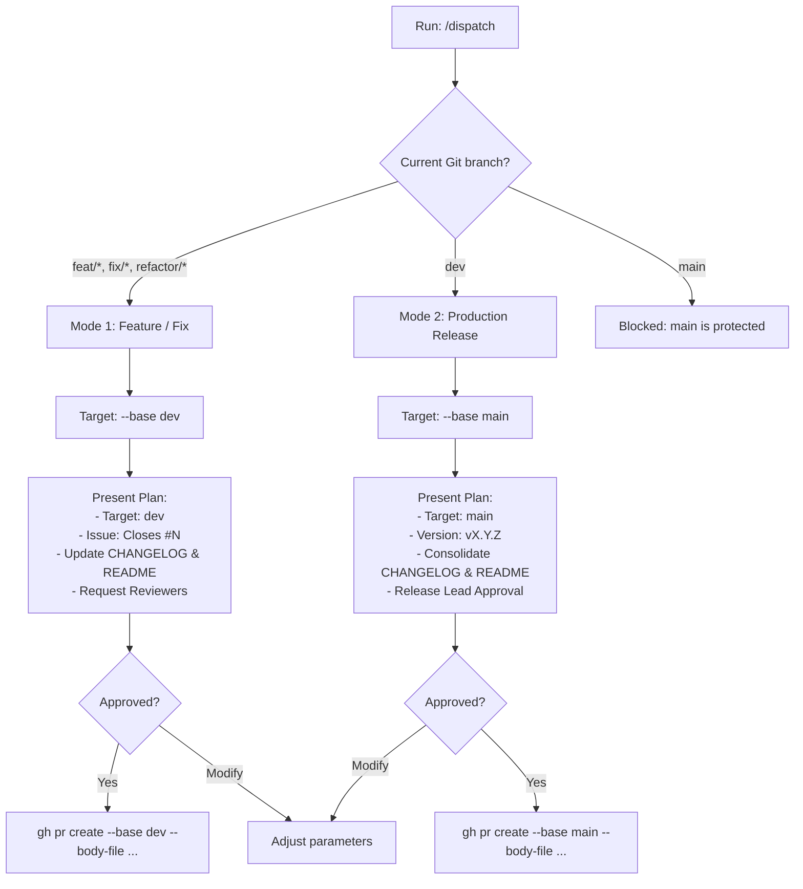
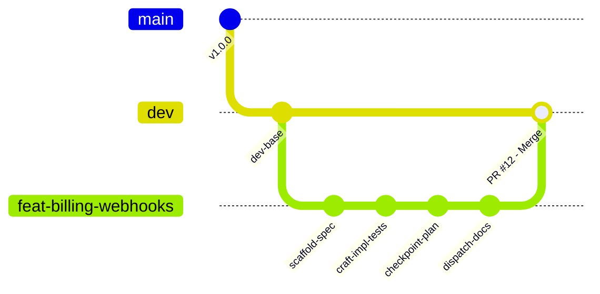

# Operational Playbook — `agy-skills`

<p align="center">
  <strong>🇺🇸 English</strong> &nbsp;|&nbsp; <a href="./PLAYBOOK.pt-BR.md"><strong>🇧🇷 Português (Brasil)</strong></a>
</p>

> **Definitive Guide to Spec-Driven Development, Git Flow Lifecycle, Antigravity Skills, and Multi-Developer Governance**

---

## Table of Contents
1. [Philosophy & Branch Topology](#1-philosophy--branch-topology)
2. [How `/dispatch` Decides the Target Branch](#2-how-dispatch-decides-the-target-branch)
3. [Scenario 1: Feature or Bug Fix (`feat/*` / `fix/*` ➔ `dev`)](#3-scenario-1-feature-or-bug-fix-feat--fix--dev)
4. [Scenario 2: Production Release (`dev` ➔ `main`)](#4-scenario-2-production-release-dev--main)
5. [Post-Merge Sync & Zombie Issue Prevention (`/dispatch sync`)](#5-post-merge-sync--zombie-issue-prevention-dispatch-sync)
6. [Git Governance Matrix](#6-git-governance-matrix)
7. [FAQ & Common Gotchas](#7-faq--common-gotchas)

---

## 1. Philosophy & Branch Topology

`agy-skills` keeps solo and team repositories fast, linear, and auditable without merge hell:

- **Two Permanent Branches (Configurable Default):**
  - `dev`: Continuous integration and staging branch. Always the most up-to-date branch.
  - `main`: Protected, stable production branch. Direct pushes are forbidden.
  - *(Single-branch repos may override the integration branch to `main` in their root `AGENTS.md`.)*
- **Ephemeral Working Branches:** Created from `origin/dev` (`feat/<name>`, `fix/<name>`, `refactor/<name>`), focused on one atomic scope, and deleted after merge.
- **Spec-First Engineering:** Every meaningful task starts with a contract in `specs/<name>.SPEC.md` and is tracked in `docs/REGISTRY.json`.

---

## 2. How `/dispatch` Decides the Target Branch

`/dispatch` never guesses blindly — it detects the mode deterministically from your current Git branch and always asks for explicit approval before mutating GitHub:



---

## 3. Scenario 1: Feature or Bug Fix (`feat/*` / `fix/*` ➔ `dev`)



### Step-by-Step

1. **Bootstrap the Task (`/scaffold`):**
   ```text
   /scaffold feat/billing-webhooks Verify Stripe webhook signatures and idempotency
   ```
   Creates `specs/billing-webhooks.SPEC.md`, registers it in `docs/REGISTRY.json`, checks out `feat/billing-webhooks` from `origin/dev`, and sets `.session.json`.

2. **Implement & Verify (`/craft`):**
   ```text
   /craft implement HMAC signature validation and retry tests
   ```
   Follows the spec, writes clean SRP code, runs tests/lint/typecheck/build, and updates the spec checklist.

3. **Audit Security & Privacy (`/shield`):**
   ```text
   /shield
   ```
   Inspects the diff against the 4 Core Laws (Secrets, XSS/Injection/CSP, AuthN/AuthZ, LGPD/GDPR).

4. **Checkpoint & Journal (`/checkpoint`):**
   ```text
   /checkpoint
   ```
   Generates `specs/checkpoints/YYYYMMDD_billing-webhooks.PLAN.md`, rebases on `origin/dev`, opens/comments on the tracking GitHub Issue, creates atomic Conventional Commits, and pushes.

5. **Open Pull Request (`/dispatch`):**
   ```text
   /dispatch
   ```
   Updates `CHANGELOG.md` and `README.md` (10-PR sliding window), commits docs on the branch, and opens a PR against `dev` with `Closes #N`.

6. **Synchronize After Merge (`/dispatch sync`):**
   ```text
   /dispatch sync
   ```
   Checks out `dev`, pulls `origin/dev`, deletes the local ephemeral branch, closes the resolved GitHub Issue (`gh issue close`), updates `README.md` to `🟣 Merged`, and resets `.session.json` (`activeModule: null`).

---

## 4. Scenario 2: Production Release (`dev` ➔ `main`)

1. Switch to `dev` and ensure it is synced with `origin/dev`.
2. Run `/dispatch` (or `/dispatch main`).
3. Confirm the target SemVer (`vX.Y.Z`) and changelog consolidation.
4. The agent consolidates `CHANGELOG.md`, bumps the manifest version, marks modules `🟢 prod-active` in `docs/REGISTRY.json`, updates `README.md`, pushes to `origin/dev`, and opens the Release PR (`dev` ➔ `main`) for the Release Lead to review and merge.

---

## 5. Post-Merge Sync & Zombie Issue Prevention (`/dispatch sync`)

GitHub only auto-closes issues referenced via `Closes #N` when a PR merges into the repository's **default branch** (`main`). When teams integrate features into `dev` first, issues stay open indefinitely ("zombie issues").

Running `/dispatch sync` right after merging a PR into `dev` guarantees:
1. Local `dev` is synced and the merged ephemeral branch is pruned.
2. Every `Closes #N` / `Fixes #N` issue from the merged PR is closed via `gh issue close <id>`.
3. `README.md` flips `🔵 In Review` ➔ `🟣 Merged`.
4. `.session.json` resets `"activeModule": null`.

---

## 6. Git Governance Matrix

| Action | Allowed? | Who | Target |
| :--- | :---: | :---: | :---: |
| Direct push to `main` | ❌ Forbidden | Nobody | — |
| Merge release into `main` | 👑 Exclusive | Release Lead | `main` |
| Feature / Fix PR | ✅ Standard | Any developer | `dev` |
| Branch off `main` for features | ❌ Forbidden | Use `origin/dev` | — |
| Sync & close issues post-merge | ✅ Standard | PR author via `/dispatch sync` | `dev` |

---

## 7. FAQ & Common Gotchas

### 1. Can I use `agy-skills` in a Python, Go, Rust, or Java project?
Yes. Every skill is 100% stack-agnostic. Configure your language's test, lint, and build commands in your project's root `AGENTS.md` (using `templates/AGENTS.template.md`).

### 2. What if my repo only has a `main` branch (no `dev`)?
Declare `main` as your integration branch in your root `AGENTS.md`. `/scaffold`, `/checkpoint`, and `/dispatch` automatically respect project-level overrides.

### 3. Why must GitHub CLI commands use `--body-file`?
On Windows PowerShell, backticks (`` ` ``) inside double-quoted strings act as escape sequences (`\v`, `\f`, `\n`, `\t`), silently corrupting code spans in GitHub issues and PRs. Writing UTF-8 (no BOM) files and passing `--body-file` works identically on Windows, macOS, and Linux.
