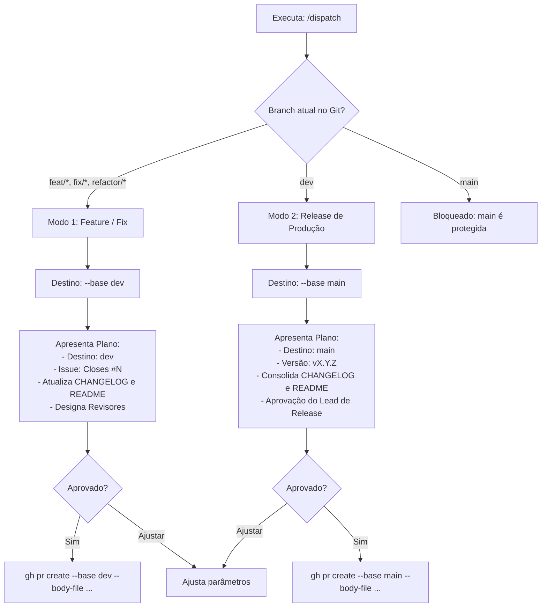
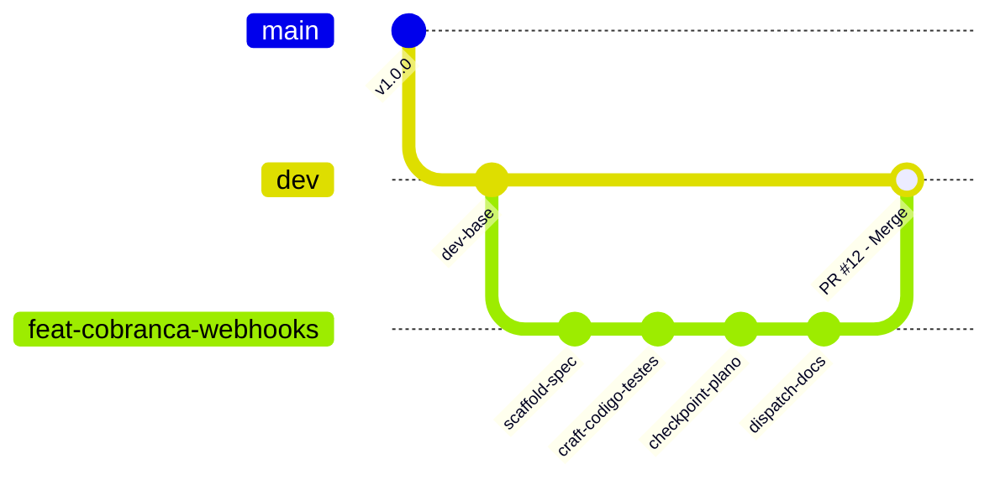

# Playbook Operacional — `agy-skills`

<p align="center">
  <a href="./PLAYBOOK.md"><strong>🇺🇸 English</strong></a> &nbsp;|&nbsp; <strong>🇧🇷 Português (Brasil)</strong>
</p>

> **Guia Definitivo de Spec-Driven Development, Ciclo de Vida Git Flow, Skills Antigravity e Governança Multi-Dev**

---

## Sumário
1. [Filosofia & Topologia de Branches](#1-filosofia--topologia-de-branches)
2. [Como o `/dispatch` Decide a Branch Destino](#2-como-o-dispatch-decide-a-branch-destino)
3. [Cenário 1: Feature ou Correção (`feat/*` / `fix/*` ➔ `dev`)](#3-cenário-1-feature-ou-correção-feat--fix--dev)
4. [Cenário 2: Release de Produção (`dev` ➔ `main`)](#4-cenário-2-release-de-produção-dev--main)
5. [Sincronização Pós-Merge & Fim das Issues Zumbis (`/dispatch sync`)](#5-sincronização-pós-merge--fim-das-issues-zumbis-dispatch-sync)
6. [Matriz de Governança Git](#6-matriz-de-governança-git)
7. [FAQ & Pegadinhas Comuns](#7-faq--pegadinhas-comuns)

---

## 1. Filosofia & Topologia de Branches

O `agy-skills` mantém repositórios solo ou em equipe rápidos, lineares e auditáveis sem *merge hell*:

- **Duas Branches Permanentes (Padrão Configurável):**
  - `dev`: Integração contínua e homologação. Sempre a branch mais atualizada.
  - `main`: Produção estável e protegida contra push direto.
  - *(Repositórios com apenas a branch `main` podem sobrescrever a branch de integração no `AGENTS.md` da raiz.)*
- **Branches Efêmeras:** Nascem de `origin/dev` (`feat/<nome>`, `fix/<nome>`, `refactor/<nome>`), cumprem um escopo atômico e são excluídas após o merge.
- **Spec-First:** Toda tarefa relevante nasce com um contrato técnico em `specs/<nome>.SPEC.md` e registro em `docs/REGISTRY.json`.

---

## 2. Como o `/dispatch` Decide a Branch Destino

O `/dispatch` nunca chuta o alvo — ele decide de forma determinística pela branch atual no Git e sempre solicita aprovação antes de alterar o GitHub:



---

## 3. Cenário 1: Feature ou Correção (`feat/*` / `fix/*` ➔ `dev`)



### Passo a Passo

1. **Iniciar a Tarefa (`/scaffold`):**
   ```text
   /scaffold feat/cobranca-webhooks Validar assinatura HMAC e idempotência de webhooks
   ```
   Cria `specs/cobranca-webhooks.SPEC.md`, registra no `docs/REGISTRY.json`, abre `feat/cobranca-webhooks` a partir de `origin/dev` e foca `.session.json`.

2. **Implementar & Validar (`/craft`):**
   ```text
   /craft implementar validação HMAC e testes de retentativa
   ```
   Segue a especificação, escreve código limpo (SRP), roda testes/lint/typecheck/build e atualiza o checklist da SPEC.

3. **Auditar Segurança & Privacidade (`/shield`):**
   ```text
   /shield
   ```
   Inspeciona o diff contra as 4 Leis (Segredos, Anti-XSS/Injeção/CSP, AuthN/AuthZ e LGPD/GDPR).

4. **Salvar Checkpoint & Journal (`/checkpoint`):**
   ```text
   /checkpoint
   ```
   Gera `specs/checkpoints/YYYYMMDD_cobranca-webhooks.PLAN.md`, executa rebase em `origin/dev`, abre/comenta na Issue do GitHub, cria Conventional Commits atômicos e envia push.

5. **Abrir Pull Request (`/dispatch`):**
   ```text
   /dispatch
   ```
   Atualiza `CHANGELOG.md` e `README.md` (janela deslizante de 10 PRs), commita a documentação e abre PR para `dev` com `Closes #N`.

6. **Sincronizar Pós-Merge (`/dispatch sync`):**
   ```text
   /dispatch sync
   ```
   Volta para `dev`, faz `git pull origin dev`, remove a branch efêmera local, fecha a Issue resolvida no GitHub (`gh issue close`), atualiza o `README.md` para `🟣 Merged` e reseta `.session.json` (`activeModule: null`).

---

## 4. Cenário 2: Release de Produção (`dev` ➔ `main`)

1. Alterne para `dev` e garanta sincronização com `origin/dev`.
2. Execute `/dispatch` (ou `/dispatch main`).
3. Confirme a versão SemVer (`vX.Y.Z`) e a consolidação do changelog.
4. O agente consolida o `CHANGELOG.md`, atualiza a versão do manifesto, marca módulos como `🟢 prod-active` em `docs/REGISTRY.json`, atualiza o `README.md`, envia push para `origin/dev` e abre o PR de Release (`dev` ➔ `main`) para aprovação exclusiva do Lead de Release.

---

## 5. Sincronização Pós-Merge & Fim das Issues Zumbis (`/dispatch sync`)

O GitHub só fecha automaticamente issues vinculadas via `Closes #N` quando o PR é mergeado na **branch padrão** (`main`). Quando o time integra features primeiro na `dev`, as issues permanecem abertas indefinidamente (*issues zumbis*).

Rodar `/dispatch sync` imediatamente após o merge na `dev` garante:
1. Branch `dev` local atualizada e branch efêmera removida.
2. Toda issue referenciada por `Closes #N` / `Fixes #N` fechada via `gh issue close <id>`.
3. Status no `README.md` atualizado de `🔵 Em Revisão` para `🟣 Merged`.
4. `.session.json` higienizado com `"activeModule": null`.

---

## 6. Matriz de Governança Git

| Ação | Permitido? | Quem executa? | Destino |
| :--- | :---: | :---: | :---: |
| Push direto na `main` | ❌ Proibido | Ninguém | — |
| Merge de release na `main` | 👑 Exclusivo | Lead de Release | `main` |
| PR de Feature / Fix | ✅ Padrão | Qualquer dev | `dev` |
| Criar branch a partir de `main` | ❌ Proibido | Use `origin/dev` | — |
| Sync e fechamento de issues pós-merge | ✅ Padrão | Autor via `/dispatch sync` | `dev` |

---

## 7. FAQ & Pegadinhas Comuns

### 1. Posso usar `agy-skills` em projetos Python, Go, Rust ou Java?
Sim! Todas as skills são 100% agnósticas de stack. Basta declarar os comandos de teste, lint e build no `AGENTS.md` da raiz do projeto (usando `locales/pt-BR/templates/AGENTS.template.md`).

### 2. E se meu repositório usar apenas a branch `main` (sem `dev`)?
Declare `main` como branch de integração no `AGENTS.md` da raiz. `/scaffold`, `/checkpoint` e `/dispatch` respeitam automaticamente as sobrescritas do projeto.

### 3. Por que o `gh` exige `--body-file`?
No Windows PowerShell, crases (`` ` ``) dentro de strings com aspas duplas atuam como caracteres de escape (`\v`, `\f`, `\n`, `\t`), corrompendo blocos de código em issues e PRs no GitHub. Salvar arquivos UTF-8 sem BOM e passar `--body-file` funciona igualmente bem no Windows, macOS e Linux.
