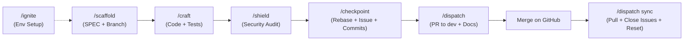

# agy-skills — Spec-Driven Development Toolkit for Google Antigravity

<p align="center">
  <strong>🇺🇸 English</strong> &nbsp;|&nbsp; <a href="./README.pt-BR.md"><strong>🇧🇷 Português (Brasil)</strong></a>
</p>

<p align="center">
  
  
  
  
</p>

A **stack-agnostic, battle-tested suite of 8 skills, operational rules, and starter templates** for **Google Antigravity** (CLI, App, and IDE).

Turn any repository — Web, Backend, Mobile, CLI, or Monorepo — into a deterministic **Spec-Driven Development** workspace with GitHub Flow governance, interactive anti-skip guardrails, automated issue lifecycle management, and built-in security audits.

> 📖 **Full Operational Guide:** Read [PLAYBOOK.md](./PLAYBOOK.md) ([🇧🇷 PLAYBOOK.pt-BR.md](./PLAYBOOK.pt-BR.md)) for step-by-step Git Flow walkthroughs, Mermaid diagrams, and FAQ.

---

## The 8 Operational Skills

| Command | Role | What It Does |
| :--- | :---: | :--- |
| **`/ignite`** | Onboarding | Idempotently validates runtimes, dependencies, `.env`, `.gitignore`, GitHub CLI (`gh`), and `.session.json`. |
| **`/scaffold <type>/<name>`** | Planning | Creates a canonical spec in `specs/<name>.SPEC.md`, registers it in `docs/REGISTRY.json`, cuts an ephemeral branch off `origin/dev`, and sets `.session.json`. |
| **`/focus [module]`** | Context | Sets or inspects `activeModule` in local `.session.json` (gitignored) to isolate work across solo or multi-dev sessions. |
| **`/craft [context]`** | Engineering | Senior-engineer implementation loop guided by `SPEC.md`, Clean Code (SRP), design-system compliance, tests, and builds. |
| **`/shield`** | Security | Active/passive audit covering the **4 Core Laws**: Secrets Hygiene, Anti-XSS/Injection & CSP, AuthN/AuthZ, and Privacy (LGPD/GDPR). |
| **`/checkpoint`** | Packaging | Rebases on `origin/dev`, scans for secrets, generates `specs/checkpoints/YYYYMMDD_<module>.PLAN.md`, posts a GitHub Issue journal, creates atomic Conventional Commits, and pushes. |
| **`/dispatch [dev \| main \| sync]`** | Delivery | Opens PRs to `dev` (features/fixes) or `main` (releases), updates `README.md` & `CHANGELOG.md`, and on `/dispatch sync` pulls `dev`, closes zombie GitHub issues, updates PR statuses, and resets `.session.json`. |
| **`/matrix [sync \| schema]`** | Architecture | Queries and reconciles the project's canonical catalog (`docs/REGISTRY.json`) against actual source files and specs. |

---

## Canonical Governance Pipeline



### Key Guardrails Built In
- **Plan-Validate-Execute:** `/scaffold`, `/checkpoint`, and `/dispatch` always present an explicit plan and wait for confirmation (`ask_question`) before mutating Git history or GitHub state.
- **Anti-Skip Protection:** Running `/craft` without an active module, `/checkpoint` without `/shield` on security-sensitive changes, or `/dispatch` with uncommitted changes pauses and recommends the prerequisite step.
- **Zero Zombie Issues:** GitHub does not auto-close `Closes #N` issues when PRs merge into `dev` — `/dispatch sync` automatically closes every resolved issue via `gh issue close`.
- **Safe Cross-Platform Shell Encoding:** All GitHub Issue and PR Markdown bodies are written to UTF-8 (no BOM) temporary files and passed with `--body-file` to avoid PowerShell backtick corruption.

---

## Installation

Choose the setup that best fits your workflow:

### Option 1 — Install Globally as a Native Antigravity Plugin (Recommended)
Works automatically across **all** your projects with zero duplication via the official `agy plugin install` CLI:

**English (auto-adapts responses to your conversation or `AGENTS.md` language):**
```bash
git clone https://github.com/Leosdc/agy-skills.git
agy plugin install ./agy-skills
```

**Português do Brasil (plugin nativo 100% em PT-BR):**
```bash
git clone https://github.com/Leosdc/agy-skills.git
agy plugin install ./agy-skills/locales/pt-BR
```

*(You can verify any plugin locally anytime with `agy plugin validate ./agy-skills --strict` and inspect active plugins with `agy plugin list`.)*

### Option 2 — Install Inside a Specific Repository (`.agents/`)
Ideal for sharing identical rules and skills with your entire team via Git:

```bash
# English version
mkdir -p .agents
cp -r /path/to/agy-skills/skills .agents/
cp -r /path/to/agy-skills/rules .agents/

# Or Português do Brasil version
mkdir -p .agents
cp -r /path/to/agy-skills/locales/pt-BR/skills .agents/
cp -r /path/to/agy-skills/locales/pt-BR/rules .agents/
```

### Option 3 — Bootstrap Any Project with Starter Templates
Copy the starter templates into your repository root and customize placeholders:

| Template | Destination in Your Repo | Purpose |
| :--- | :--- | :--- |
| `templates/AGENTS.template.md` | `AGENTS.md` | Project stack, team leads, branch defaults, build/test commands |
| `templates/REGISTRY.template.json` | `docs/REGISTRY.json` | Machine-readable catalog for `/matrix` and `/scaffold` |
| `templates/PULL_REQUEST_TEMPLATE.md` | `.github/PULL_REQUEST_TEMPLATE.md` | Standardized PR checklist for `/dispatch` |
| `templates/CHANGELOG.template.md` | `CHANGELOG.md` | Keep a Changelog file with `## [Unreleased / Dev]` |
| `templates/session.example.json` | `.session.json` *(gitignored)* | Local developer context file for `/focus` |

*(PT-BR equivalents are available under `locales/pt-BR/templates/`.)*

---

## Repository Structure

```text
agy-skills/
├── plugin.json                     # Native Antigravity plugin manifest (EN, language-adaptive)
├── README.md                       # Documentation (English)
├── README.pt-BR.md                 # Documentação (Português do Brasil)
├── PLAYBOOK.md                     # Operational Git Flow Playbook (English)
├── PLAYBOOK.pt-BR.md               # Playbook Operacional Git Flow (Português do Brasil)
├── LICENSE                         # MIT License
├── rules/                          # Consolidated & modular engineering rules (EN)
│   ├── AGENTS.md
│   ├── architecture.md
│   ├── git-governance.md
│   └── security.md
├── skills/                         # The 8 Antigravity skills (EN)
│   ├── ignite/SKILL.md
│   ├── scaffold/SKILL.md
│   ├── focus/SKILL.md
│   ├── craft/SKILL.md
│   ├── shield/SKILL.md
│   ├── checkpoint/SKILL.md
│   ├── dispatch/SKILL.md
│   └── matrix/SKILL.md
├── templates/                      # Project starter templates (EN)
└── locales/
    └── pt-BR/                      # Complete 1:1 native plugin & drop-in pack in PT-BR
        ├── plugin.json
        ├── rules/
        ├── skills/
        └── templates/
```

---

## Contributing & License

Contributions, improvements, and additional locale packs are welcome via Pull Request!
Released under the [MIT License](./LICENSE).
