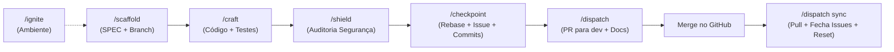

# agy-skills — Kit de Spec-Driven Development para Google Antigravity

<p align="center">
  <a href="./README.md"><strong>🇺🇸 English</strong></a> &nbsp;|&nbsp; <strong>🇧🇷 Português (Brasil)</strong>
</p>

<p align="center">
  
  
  
  
</p>

Uma **suíte agnóstica de stack e testada em produção com 8 skills, regras operacionais e templates iniciais** para **Google Antigravity** (CLI, App e IDE).

Transforme qualquer repositório — Web, Backend, Mobile, CLI ou Monorepo — em um ambiente determinístico de **Spec-Driven Development** com governança GitHub Flow, questionários interativos anti-fuga, ciclo completo de Issues no GitHub e auditoria de segurança embutida.

> 📖 **Guia Operacional Completo:** Consulte o [PLAYBOOK.pt-BR.md](./PLAYBOOK.pt-BR.md) ([🇺🇸 PLAYBOOK.md](./PLAYBOOK.md)) para o passo a passo de Git Flow, diagramas Mermaid e FAQ.

---

## As 8 Skills Operacionais

| Comando | Papel | O que faz |
| :--- | :---: | :--- |
| **`/ignite`** | Onboarding | Valida de forma idempotente runtimes, dependências, `.env`, `.gitignore`, GitHub CLI (`gh`) e `.session.json`. |
| **`/scaffold <tipo>/<nome>`** | Planejamento | Cria especificação canônica em `specs/<nome>.SPEC.md`, registra em `docs/REGISTRY.json`, abre branch efêmera a partir de `origin/dev` e foca `.session.json`. |
| **`/focus [modulo]`** | Contexto | Define ou consulta `activeModule` no `.session.json` local (gitignored) para isolar frentes de trabalho solo ou em equipe. |
| **`/craft [contexto]`** | Engenharia | Loop interativo de engenharia sênior guiado pela `SPEC.md`, Clean Code (SRP), conformidade visual/temas, testes e build. |
| **`/shield`** | Segurança | Auditoria ativa/passiva baseada nas **4 Leis de Segurança**: Blindagem de Segredos, Anti-XSS/Injeção & CSP, AuthN/AuthZ e Privacidade (LGPD/GDPR). |
| **`/checkpoint`** | Fechamento | Faz rebase em `origin/dev`, varre segredos, gera `specs/checkpoints/YYYYMMDD_<modulo>.PLAN.md`, registra journal em Issue do GitHub, cria Conventional Commits atômicos e envia push. |
| **`/dispatch [dev \| main \| sync]`** | Entrega | Abre PRs para `dev` (features/fixes) ou `main` (releases), sincroniza `README.md` e `CHANGELOG.md`, e no `/dispatch sync` atualiza a `dev`, fecha issues zumbis, atualiza status dos PRs e limpa `.session.json`. |
| **`/matrix [sync \| schema]`** | Arquitetura | Consulta e reconcilia o catálogo canônico do projeto (`docs/REGISTRY.json`) frente aos arquivos reais e especificações. |

---

## Esteira Canônica de Governança



### Salvaguardas Integradas
- **Plan-Validate-Execute:** `/scaffold`, `/checkpoint` e `/dispatch` sempre exibem o plano detalhado e aguardam aprovação explícita (`ask_question`) antes de alterar histórico Git ou recursos no GitHub.
- **Proteção Anti-Fuga:** Tentar rodar `/craft` sem módulo ativo, `/checkpoint` sem `/shield` em alterações sensíveis ou `/dispatch` com working tree suja interrompe a execução e recomenda a etapa prévia necessária.
- **Zero Issues Zumbis:** Como o GitHub não fecha automaticamente `Closes #N` ao mergear em `dev`, o `/dispatch sync` encerra automaticamente cada issue resolvida via `gh issue close`.
- **Codificação Segura Multiplataforma:** Todos os corpos Markdown de Issues e PRs são salvos em arquivos UTF-8 sem BOM e enviados via `--body-file`, evitando corrupção de crases (`` ` ``) no PowerShell.

---

## Instalação

Escolha o modo que melhor atende ao seu projeto ou equipe:

### Opção 1 — Instalar Globalmente como Plugin Nativo do Antigravity (Recomendado)
Funciona automaticamente em **todos** os seus projetos sem duplicar arquivos usando a CLI oficial `agy plugin install`:

**Português do Brasil (plugin nativo 100% em PT-BR):**
```bash
git clone https://github.com/Leosdc/agy-skills.git
agy plugin install ./agy-skills/locales/pt-BR
```

**Versão em Inglês (adapta-se automaticamente ao idioma da conversa ou do `AGENTS.md`):**
```bash
git clone https://github.com/Leosdc/agy-skills.git
agy plugin install ./agy-skills
```

*(Você pode validar localmente com `agy plugin validate ./agy-skills/locales/pt-BR --strict` e conferir os plugins ativos com `agy plugin list`.)*

### Opção 2 — Instalar Dentro de um Repositório Específico (`.agents/`)
Ideal para versionar e compartilhar as mesmas skills e regras com toda a equipe via Git:

```bash
# Versão em Português do Brasil
mkdir -p .agents
cp -r /caminho/para/agy-skills/locales/pt-BR/skills .agents/
cp -r /caminho/para/agy-skills/locales/pt-BR/rules .agents/

# Ou versão em Inglês
mkdir -p .agents
cp -r /caminho/para/agy-skills/skills .agents/
cp -r /caminho/para/agy-skills/rules .agents/
```

### Opção 3 — Preparar Qualquer Projeto com os Templates Iniciais
Copie os templates de `locales/pt-BR/templates/` para o repositório alvo e preencha os placeholders:

| Template | Destino no seu Projeto | Finalidade |
| :--- | :--- | :--- |
| `locales/pt-BR/templates/AGENTS.template.md` | `AGENTS.md` | Stack, equipe, branches padrão e comandos de teste/build |
| `locales/pt-BR/templates/REGISTRY.template.json` | `docs/REGISTRY.json` | Catálogo estruturado para `/matrix` e `/scaffold` |
| `locales/pt-BR/templates/PULL_REQUEST_TEMPLATE.md` | `.github/PULL_REQUEST_TEMPLATE.md` | Checklist padronizado de PR para `/dispatch` |
| `locales/pt-BR/templates/CHANGELOG.template.md` | `CHANGELOG.md` | Histórico Keep a Changelog com `## [Unreleased / Dev]` |
| `locales/pt-BR/templates/session.example.json` | `.session.json` *(gitignored)* | Arquivo local de contexto ativo para `/focus` |

---

## Estrutura do Repositório

```text
agy-skills/
├── plugin.json                     # Manifesto de plugin nativo Antigravity (EN, adaptativo)
├── README.md                       # Documentação (Inglês)
├── README.pt-BR.md                 # Documentação (Português do Brasil)
├── PLAYBOOK.md                     # Playbook Operacional Git Flow (Inglês)
├── PLAYBOOK.pt-BR.md               # Playbook Operacional Git Flow (Português do Brasil)
├── LICENSE                         # Licença MIT
├── rules/                          # Regras de engenharia consolidadas e modulares (EN)
├── skills/                         # As 8 skills Antigravity (EN)
├── templates/                      # Templates iniciais de projeto (EN)
└── locales/
    └── pt-BR/                      # Pacote completo 1:1 em Português do Brasil (plugin + .agents/)
        ├── plugin.json
        ├── rules/
        ├── skills/
        └── templates/
```

---

## Contribuição & Licença

Contribuições, melhorias e novos pacotes de idiomas são muito bem-vindos via Pull Request!
Distribuído sob a [Licença MIT](./LICENSE).
